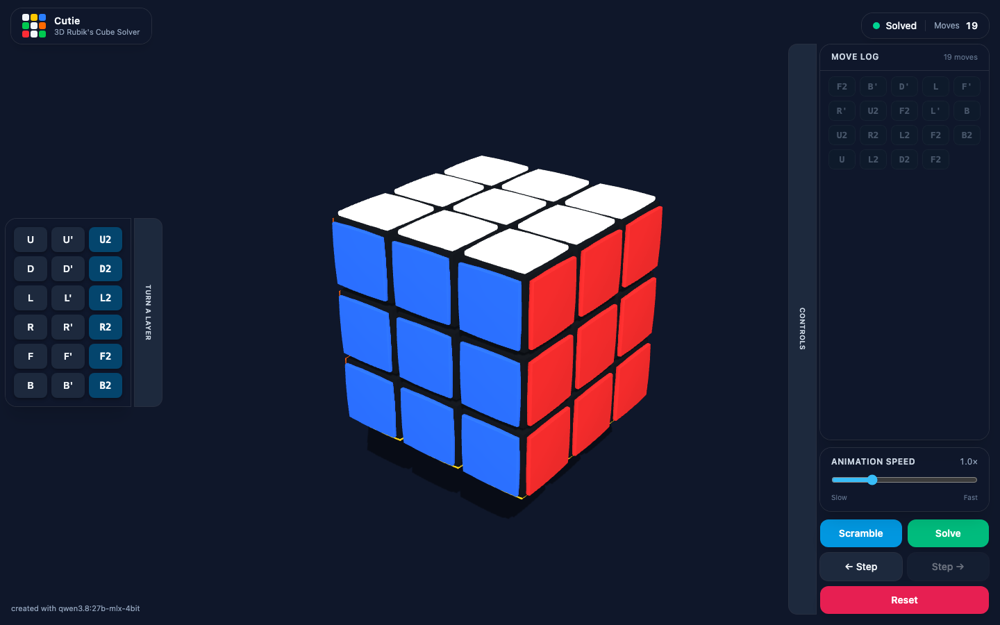

# Cutie — 3D Rubik's Cube Solver

**Cutie** is a single-file, fully client-side 3D Rubik's Cube simulation and
solver, created with qwen3.8:27b-mlx-4bit. [Try it here](https://telonniko.github.io/cutie/).  It renders a real 
3×3×3 cube in your browser with **Three.js**, lets you scramble and turn it by hand, and then uses 
**[cubejs](https://www.cs.usc.edu/~pwadler/cubelys/cubejs.html)** to compute and animate the exact sequence of 
moves that solves it — step by step, on screen.

Everything runs locally: no backend, no build step. Just open `index.html`.

---

## Screenshots

A full solve in three frames — solved → scrambled → solved-again:

| Solved | Scrambled | Solved again |
|:--:|:--:|:--:|
|  |  |  |

Open the [gallery](docs/screenshots/index.html) for larger, captioned versions.

---

## How to run

Double-click `index.html` in your file manager and open it in a modern browser
(Chrome, Edge, Firefox, or Safari). That's all you need — every feature
(scramble, solve, step, reset) runs locally with no server and no build step.

---

## How to play

1. **Start solved.** The cube loads in a clean, fully-solved state (each face one
   color). The status pill top-right reads **Solved**.
2. **Scramble it.** Click **Scramble** (or press `S`) to apply a random sequence
   of moves with a quick animation. Status flips to **Scrambled**.
   — or turn faces by hand with the **face buttons** or **keyboard** (dragging on
   the cube only orbits the camera).
3. **Solve it.** Click **Solve** (or press `Space`). cubejs computes the shortest
   solution and the cube animates back to order one move at a time, while the
   **Move Log** lights up each move-button in turn as that face turns. The log
   is **cleared first** so it shows just the solution — and it solves the cube as
   it *currently* is, so it works even after you've stepped back or turned a
   face by hand. Status returns to **Solved**.
4. **Explore.** Step forward/backward to move a **current step** cursor through
   the log (the cube always reflects moves up to that step). Turn a face to
   branch the log from the current step, or reset and try again.

---

## The UI

The interface is a dark, glassy overlay floating over the 3D viewport.

### Layout — the whole app lives in a capped, centered stage
Everything — the canvas, the top banner, the Move Log, the control drawer, the
toast — lives inside a single **stage** box that is **horizontally centered and
anchored to the top of the window** (flush with the top edge), capped at
**1276px wide × min(100dvh, 1366px) tall** — the height cap uses the
*dynamic* viewport height (`100dvh`), so on mobile the stage tracks the
visible area as browser toolbars collapse and expand. When the window is
smaller than the caps the stage fills it and nothing changes; on a larger
window the leftover space
becomes a **letterbox margin** on the sides (and at the **bottom**, when the
viewport is taller than 1366px). The page background is the same slate-900 as
the 3D scene, so the margin blends in seamlessly and the app simply looks a
little smaller — nothing moves or re-wraps. The chrome size caps are
stage-relative (Move Log ≤ 45% and control panel ≤ 95% of the *stage* height,
not the viewport's), so they scale with the stage.

### 3D viewport (the stage's empty space)
- **Drag** to orbit the camera around the cube.
- **Scroll / pinch** to zoom.

The WebGL canvas no longer backs the whole stage: it fills exactly the
**empty space** — the stage minus the top banner band, the left drawer band,
and the bottom Move Log band, each leaving a **16px clearance** so the cube
never sits under chrome (the bottom band is the Move Log's *reserved* height,
computed as if it had exactly 3 button rows, not its dynamic height; in the
narrow-tall band the log docks to the right edge instead — the right band is
then 16px + the card's width and the bottom band drops to 0, see the Move Log
section below). The cube
always projects to the exact center of its canvas, so sizing the canvas to the
empty rectangle keeps the **cube centered in the empty space at every
viewport size**. When the drawer **closes**, a per-frame loop tracks the
panel's slide and re-sizes the canvas each frame, so the **cube slides left
with the drawer** instead of jumping when the slide ends; **opening** is an
instant reflow.

The cube itself is **view-only** — turns come from the **face buttons** and
**keyboard shortcuts** (below), not from clicking the cube.

### Top bar
- A **full-width banner** fixed to the **stage's** top edge — one continuous dark strip, only
  a hair lighter than the visible slate-900 scene background — holding both items.
- **Cutie** logo (left), with a small "by Qwen3.8" credit right next to
  the title.
- **Status pill** (right): a colored dot + label showing the current state
  (**Solved**, **Scrambled**, **Turning…**, **Solving…**) and a live **Moves**
  counter.

### Move Log (bottom edge — or right edge) — an always-visible panel
The Move Log is a panel that is **always visible** — no drawer, no tab, no
toggle, no keyboard shortcut. By default it is **fixed at the bottom of the
stage**: the wrapper spans the stage's bottom width minus a **4px gap at each
edge** (`left-1` / `right-1`), and the glassy card **fills that width** —
title row and moves alike — with the canvas/cube untouched. When the stage is
**784px tall or shorter** (no lower bound — the rule is height-only,
width-independent) the same card **re-docks to the right edge** instead: a
**headerless** card (title and count hidden in-band — only the move-buttons)
with 16px clearances below the banner, at the right edge, and at the stage
bottom. The buttons fill **columns top→bottom** (32px buttons, 2px gaps,
31px row pitch), and the card **grows one column at a time** as moves
accumulate — 1 column (58px) at 0 moves up to a 5-column cap (194px),
**58/92/126/160/194px** for 1–5 columns. While the moves fit in the 5 columns
there is **no scrollbar**; only below a ≈332px stage height does the log
exceed the 5-column capacity and scroll internally (the width stays capped at
194px). The canvas re-sizes around the live card width (16px + the card,
re-measured as the columns grow), and the **cube re-centers in the remaining
space**. Above 784px the bottom dock stands:
- **Header** — "Move Log" title plus a live **move-count** (e.g. `12 moves`).
- **Move buttons** — the executed moves shown as a **row of move-buttons that
  wraps**, one per token (`R`, `U'`, `F2`, …), styled to match the face buttons.
  Each button is a **fixed 32px wide**, so the layout is identical at every
  screen size: buttons **auto-wrap at the panel's width**, centered, adding
  rows as moves are added — no horizontal overflow. (Right-docked, the same
  buttons fill **columns** instead of rows — each column top→bottom, then the
  next column rightward — 32px buttons, 2px gaps.)
- **Scroll** — the card grows with rows but caps at 45% of the **stage height**
  (a stage-relative cap, so it scales with the stage), then scrolls internally
  (right-docked, the 45% cap does not apply — the columns fill the card with
  no scrollbar while the moves fit; only past the 5-column capacity, below a
  ≈332px stage, does the card scroll internally); the button for the move being turned
  **highlights first, then the face turns, then the next one** — moves before
  the current step show as done, moves after it as pending — and the current
  button auto-scrolls into view.

  (The speed slider and the primary-action buttons live in the control
  drawer on the left — see below.)

### Control panel (left edge) — a slide-out drawer
The control panel — the face buttons, the animation-speed slider, and the five
action buttons — lives in a panel that **hides behind a tab** on the left edge,
so the cube's empty space stays clear. Its **open/closed state is
width-based**: the drawer **starts open when the stage is wider than 750px**
and starts **closed at 750px or narrower**, and a Scramble/Solve **auto-closes**
an open drawer only when the stage is 750px or narrower at click time — on a
wide stage the clicks simply leave it open. So the drawer starts **open** on a
wide screen and **closed** on a narrow one (e.g. 360×780), where only its
binder tab peeks in from the edge. Vertically, the panel is **centered**
between the banner and the Move Log's top when the stage is taller than
784px (bottom-docked log); at 784px or shorter (right-docked log) it is
centered between the banner and the **stage's bottom** while the stage is at
least 635px tall (the open panel fits), and pinned just below the banner
below 635px (it may clip the stage's bottom). The tab is a vertical
**"Control Panel"** handle (like a tab in a binder) that sits on the panel's
**right** edge; it is always visible — when closed, the panel slides fully off
the stage's left edge (clipped by the stage) and the tab stays peeking in from
that edge — and the panel itself slides in from the left when opened:

- **Tap the tab** to slide the panel out and reveal the controls; **tap it again**
  to slide it back. The toggle is a `click` on a real `<button>`, so it works
  with a tap on iPad with no keyboard.
- **`C`** toggles the same drawer from the keyboard. (Tab is not used: it
  drives browser focus navigation, and the primary action buttons are focusable.)

When open, the panel is one tall card that stacks, top to bottom: the three
vertical columns of face buttons (each column labelled **CW** / **CCW** /
**Half** above its buttons), the animation-speed slider, and the five
primary-action buttons in an inner bordered sub-panel. Each face button is
**one fixed move**, so a tap always does exactly one thing with no modifier —
this matters on touch devices (e.g. iPad) that have no Shift key. Each button
turns its layer on the live cube the moment it is **released**:

- **Left column — clockwise quarter turns: `U D L R F B`.** Each is a 90° turn.
- **Middle column — counter-clockwise quarter turns: `U' D' L' R' F' B'`.** Each is a 90° prime.
- **Right column — half turns: `U2 D2 L2 R2 F2 B2`.** Each is a 180° turn.

Labels are fixed (a 180° has no direction, and the prime is its own button), so
there is no modifier to watch and nothing to repaint.

At the bottom of the panel, below the face columns, sit the slider and the
action buttons:

- **Animation speed** — a slider (0.3×–3×) that controls how fast every
  scramble/solve/turn animates. It sits between the face columns and the
  action buttons.
- **Primary actions** (in an inner bordered sub-panel):
  | Button | Action |
  | --- | --- |
  | **Scramble** | Apply a random scramble with animation (clears the log first). |
  | **Solve** | Clear the log, then compute + animate the solution for the cube as it is now. |
  | **← Step** | Step the current position back one move (undo, keeping it in the log to replay). Disabled at the start of the log — nothing applied yet to undo. |
  | **Step →** | Advance the current step one move (replay the next move in the log). Disabled at the end of the log — nothing left to replay. |
  | **Reset** | Instantly return the cube to the solved state. |

  The two step buttons **disable themselves** when there is no move in that
  direction: **← Step** greys out at the start of the log (nothing applied to
  undo) and **Step →** greys out at the end (nothing future to replay). In the
  middle of the log both are live. The flags refresh only when a move finishes
  and the sequence settles, so a Scramble/Solve animating through many moves
  never flickers the buttons on screen.

The turns fire on **pointer release**, not the browser's synthesized `click`
event: Safari can drop that event after a tap, so triggering on `pointerup`
keeps the buttons responsive across browsers. On desktop, the face keys
(`U D L R F B`, `Shift` + a face key for the prime, `Alt` + a face key for the
half turn) still work as shortcuts.

---

## Keyboard shortcuts

| Key | Action |
| --- | --- |
| `Space` | Solve |
| `S` | Scramble |
| `0` | Reset |
| `→` | Step forward |
| `←` | Step backward |
| `U` `D` `L` `R` `F` `B` | Turn that face clockwise |
| `Shift` + `U D L R F B` | Turn that face counter-clockwise |
| `Alt` + `U D L R F B` | Turn that face 180° (half turn) |
| `C` | Toggle the control panel drawer open / closed |

(`C` was previously the removed controls-drawer key — it is free again. `T` no
longer toggles the drawer.)

---

## Move notation

Moves use standard **Singmaster notation**:

| Symbol | Face / meaning |
| --- | --- |
| `U` `D` `L` `R` `F` `B` | Up, Down, Left, Right, Front, Back faces |
| `X'` | `X` face, counter-clockwise (e.g. `R'`) |
| `X2` | `X` face, 180° half turn (e.g. `F2`) |

Move notation is what the **Move Log** shows.

---

## Move limit

The Move Log holds at most **36 moves** in total — the cap applies to solves,
scrambles, and hand face turns alike.

- **Face turn at the cap** — with 36 moves in the log, a 37th turn is refused:
  the cube does not turn and the move is not logged. A brief toast (~1
  second, fading out) reads **Maximum moves allowed: 36**. Stepping back to
  undo a move frees a slot, so you can turn again.
- **Solve at the cap** — if the solver comes back with a sequence longer than
  36 moves, the answer is refused *before* the log is cleared or the queue is
  filled: the log and the cube are left exactly as they were, and a brief
  toast reads **Failed to find a solve solution**.
- **Scrambles** (18–24 moves) never reach the cap and are unaffected.

---

## How it works

- **27 cubies** are built as individual 3D objects in a 3×3×3 grid, each with the
  standard face colors — White (U), Yellow (D), Blue (F), Green (B), Orange (L),
  Red (R).
- Turns rotate a *slice* of cubies with a smooth 3D animation; the internal state
  is kept in **facelet** form (`UUUUUUUURRRRRRRRFFFFFFFDDDDDDDDLLLLLLLLLBBBBBBBBB`)
  so the cube's representation matches the solver exactly.
- **Solving** clears the Move Log, then reads the cube's facelet string for its
  current physical state, hands it to cubejs (`Cube.fromString(...).solve()`),
  and animates the returned move sequence from where the cube currently is.
  Stepping back/forward or a hand turn moves a **current step** cursor through the
  log — the cube always reflects moves up to that step, and a hand turn branches
  the log from it (discarding any later moves) — so Solve always starts from the
  cube as it actually is.
- The UI (Tailwind), rendering (Three.js), and solver (cubejs) are all pulled in
  from CDNs, keeping the whole app in one `index.html` file.

---

## Tech

- [Three.js](https://threejs.org/) — 3D rendering & camera controls
- [cubejs](https://www.cs.usc.edu/~pwadler/cubelys/cubejs.html) — optimal solver
- [Tailwind CSS v4](https://tailwindcss.com/) — UI styling (browser build)
- Vanilla JavaScript — game logic & animations

No backend required.
