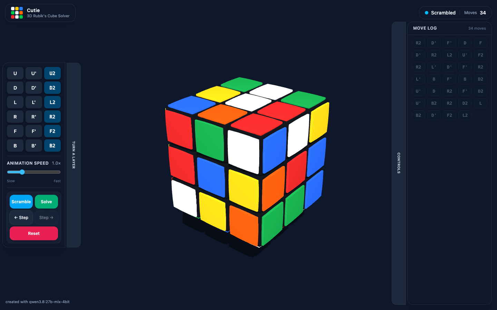

# Cutie — 3D Rubik's Cube Solver

**Cutie** is a single-file, fully client-side 3D Rubik's Cube simulation and
solver, created with qwen3.8:27b-mlx-4bit. [Try it here](https://telonniko.github.io/cutie/).  It renders a real 
3×3×3 cube in your browser with **Three.js**, lets you scramble and turn it by hand, and then uses 
**[cubejs](https://www.cs.usc.edu/~pwadler/cubelys/cubejs.html)** to compute and animate the exact sequence of 
moves that solves it — step by step, on screen.

Everything runs locally: no backend, no build step. Just open `index.html`.

---

## Screenshots

A full solve in three frames — solved → scrambled → solved-again:

| Solved | Scrambled | Solved again |
|:--:|:--:|:--:|
|  |  |  |

Open the [gallery](docs/screenshots/index.html) for larger, captioned versions.

---

## How to run

Double-click `index.html` in your file manager and open it in a modern browser
(Chrome, Edge, Firefox, or Safari). That's all you need — every feature
(scramble, solve, step, reset) runs locally with no server and no build step.

---

## How to play

1. **Start solved.** The cube loads in a clean, fully-solved state (each face one
   color). The status pill top-right reads **Solved**.
2. **Scramble it.** Click **Scramble** (or press `S`) to apply a random sequence
   of moves with a quick animation. Status flips to **Scrambled**.
   — or turn faces by hand with the **face buttons** or **keyboard** (dragging on
   the cube only orbits the camera).
3. **Solve it.** Click **Solve** (or press `Space`). cubejs computes the shortest
   solution and the cube animates back to order one move at a time, while the
   **Move Log** lights up each move-button in turn as that face turns. The log
   is **cleared first** so it shows just the solution — and it solves the cube as
   it *currently* is, so it works even after you've stepped back or turned a
   face by hand. Status returns to **Solved**.
4. **Explore.** Step forward/backward to move a **current step** cursor through
   the log (the cube always reflects moves up to that step). Turn a face to
   branch the log from the current step, or reset and try again.

---

## The UI

The interface is a dark, glassy overlay floating over the 3D viewport.

### 3D viewport (center)
- **Drag** to orbit the camera around the cube.
- **Scroll / pinch** to zoom.

The cube itself is **view-only** — turns come from the **face buttons** and
**keyboard shortcuts** (below), not from clicking the cube.

### Top bar
- **Cutie** logo (left).
- **Status pill** (right): a colored dot + label showing the current state
  (**Solved**, **Scrambled**, **Turning…**, **Solving…**) and a live **Moves**
  counter.

### Controls drawer (right edge) — a slide-out drawer
The Move Log lives in a panel that **hides behind a tab** on the right edge —
the mirror of the face-button drawer on the left. On a wide screen the app opens
**both** drawers at startup (cube in the gap between them); on a narrow one they
start closed, and either drawer auto-closes when a Scramble/Solve would slide it
onto the cube. The tab is a vertical **"Controls"** handle on the panel's left
edge; **`C`** toggles it from the keyboard (Tab drives focus navigation, so
it's not used here).
- **Move Log** — the executed moves shown as a **grid of move-buttons, 5 per
  row** (each button is one token like `R`, `U'`, `F2`), styled to match the
  face buttons. As a scramble or solve animates, the button for the move being
  turned **highlights first, then the face turns, then the next one** — moves
  before the current step show as done, moves after it as pending. A count of
  total moves is shown at
  the top of the card, and the panel **scrolls** when the grid is taller than the
  panel.

  (The speed slider and the primary-action buttons live in the face-button
  drawer on the left — see below.)

### Face buttons (left edge) — a slide-out drawer
The face buttons live in a panel that **hides behind a tab** on the left edge,
so the cube viewport stays clear. Like the controls drawer, it **opens at
startup on a wide screen and stays closed on a narrow one**, and auto-closes when
a Scramble/Solve would slide it onto the cube. The tab is a vertical **"Turn a
layer"** handle (like a tab in a binder) that sits on the panel's **right**
edge; it is always visible, and the panel itself slides in from the left when
opened:

- **Tap the tab** to slide the panel out and reveal the buttons; **tap it again**
  to slide it back. The toggle is a `click` on a real `<button>`, so it works
  with a tap on iPad with no keyboard.
- **`T`** toggles the same drawer from the keyboard. (Tab is not used: it
  drives browser focus navigation, and the primary action buttons are focusable.)

When open, the panel is one tall card that stacks, top to bottom: the three
vertical columns of face buttons, the animation-speed slider, and the five
primary-action buttons in an inner bordered sub-panel. Each face button is
**one fixed move**, so a tap always does exactly one thing with no modifier —
this matters on touch devices (e.g. iPad) that have no Shift key. Each button
turns its layer on the live cube the moment it is **released**:

- **Left column — clockwise quarter turns: `U D L R F B`.** Each is a 90° turn.
- **Middle column — counter-clockwise quarter turns: `U' D' L' R' F' B'`.** Each is a 90° prime.
- **Right column — half turns: `U2 D2 L2 R2 F2 B2`.** Each is a 180° turn.

Labels are fixed (a 180° has no direction, and the prime is its own button), so
there is no modifier to watch and nothing to repaint.

At the bottom of the panel, below the face columns, sit the slider and the
action buttons:

- **Animation speed** — a slider (0.3×–3×) that controls how fast every
  scramble/solve/turn animates. It sits between the face columns and the
  action buttons.
- **Primary actions** (in an inner bordered sub-panel):
  | Button | Action |
  | --- | --- |
  | **Scramble** | Apply a random scramble with animation (clears the log first). |
  | **Solve** | Clear the log, then compute + animate the solution for the cube as it is now. |
  | **← Step** | Step the current position back one move (undo, keeping it in the log to replay). Disabled at the start of the log — nothing applied yet to undo. |
  | **Step →** | Advance the current step one move (replay the next move in the log). Disabled at the end of the log — nothing left to replay. |
  | **Reset** | Instantly return the cube to the solved state. |

  The two step buttons **disable themselves** when there is no move in that
  direction: **← Step** greys out at the start of the log (nothing applied to
  undo) and **Step →** greys out at the end (nothing future to replay). In the
  middle of the log both are live. The flags refresh only when a move finishes
  and the sequence settles, so a Scramble/Solve animating through many moves
  never flickers the buttons on screen.

The turns fire on **pointer release**, not the browser's synthesized `click`
event: Safari can drop that event after a tap, so triggering on `pointerup`
keeps the buttons responsive across browsers. On desktop, the face keys
(`U D L R F B`, `Shift` + a face key for the prime, `Alt` + a face key for the
half turn) still work as shortcuts.

---

## Keyboard shortcuts

| Key | Action |
| --- | --- |
| `Space` | Solve |
| `S` | Scramble |
| `0` | Reset |
| `→` | Step forward |
| `←` | Step backward |
| `U` `D` `L` `R` `F` `B` | Turn that face clockwise |
| `Shift` + `U D L R F B` | Turn that face counter-clockwise |
| `Alt` + `U D L R F B` | Turn that face 180° (half turn) |
| `T` | Toggle the face-button (layer) drawer open / closed |
| `C` | Toggle the controls drawer open / closed |

---

## Move notation

Moves use standard **Singmaster notation**:

| Symbol | Face / meaning |
| --- | --- |
| `U` `D` `L` `R` `F` `B` | Up, Down, Left, Right, Front, Back faces |
| `X'` | `X` face, counter-clockwise (e.g. `R'`) |
| `X2` | `X` face, 180° half turn (e.g. `F2`) |

Move notation is what the **Move Log** shows.

---

## How it works

- **27 cubies** are built as individual 3D objects in a 3×3×3 grid, each with the
  standard face colors — White (U), Yellow (D), Blue (F), Green (B), Orange (L),
  Red (R).
- Turns rotate a *slice* of cubies with a smooth 3D animation; the internal state
  is kept in **facelet** form (`UUUUUUUURRRRRRRRFFFFFFFDDDDDDDDLLLLLLLLLBBBBBBBBB`)
  so the cube's representation matches the solver exactly.
- **Solving** clears the Move Log, then reads the cube's facelet string for its
  current physical state, hands it to cubejs (`Cube.fromString(...).solve()`),
  and animates the returned move sequence from where the cube currently is.
  Stepping back/forward or a hand turn moves a **current step** cursor through the
  log — the cube always reflects moves up to that step, and a hand turn branches
  the log from it (discarding any later moves) — so Solve always starts from the
  cube as it actually is.
- The UI (Tailwind), rendering (Three.js), and solver (cubejs) are all pulled in
  from CDNs, keeping the whole app in one `index.html` file.

---

## Tech

- [Three.js](https://threejs.org/) — 3D rendering & camera controls
- [cubejs](https://www.cs.usc.edu/~pwadler/cubelys/cubejs.html) — optimal solver
- [Tailwind CSS v4](https://tailwindcss.com/) — UI styling (browser build)
- Vanilla JavaScript — game logic & animations

No backend required.
