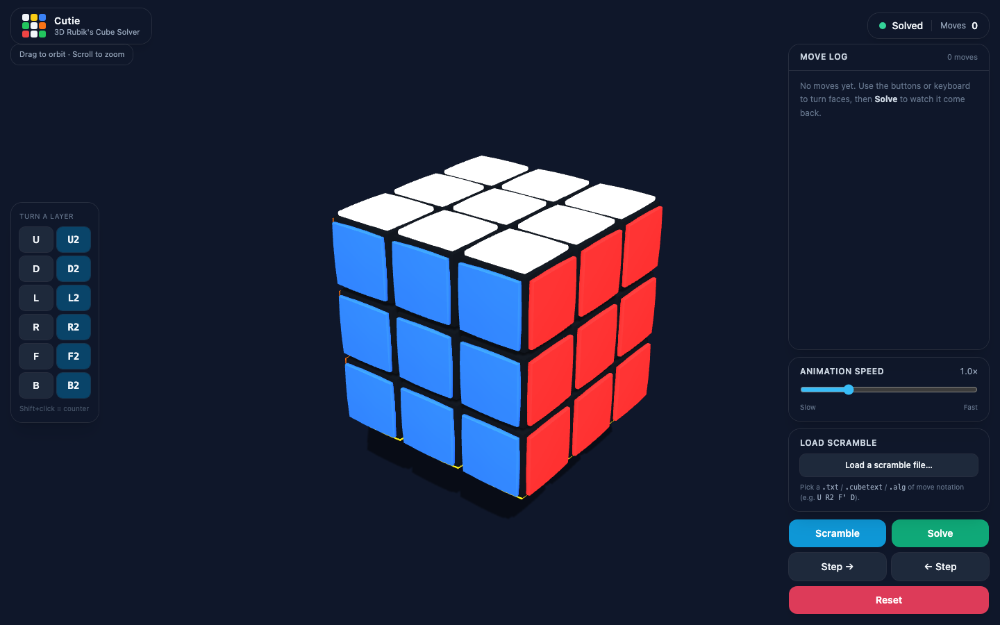

# Cutie — 3D Rubik's Cube Solver

**Cutie** is a single-file, fully client-side 3D Rubik's Cube simulation and
solver. It renders a real 3×3×3 cube in your browser with **Three.js**, lets you
scramble and turn it by hand, and then uses **[cubejs](https://www.cs.usc.edu/~pwadler/cubelys/cubejs.html)**
to compute and animate the exact sequence of moves that solves it — step by step,
on screen.

Everything runs locally: no backend, no build step. Just open `index.html`.

---

## Screenshots

A full solve in three frames — solved → scrambled → solved-again:

| Solved | Scrambled | Solved again |
|:--:|:--:|:--:|
|  |  |  |

Open the [gallery](docs/screenshots/index.html) for larger, captioned versions.

---

## How to run

There are two ways:

1. **Double-click `index.html`** in your file manager and open it in a modern
   browser (Chrome, Edge, Firefox, or Safari). This is all you need for the
   core game.
2. **Serve it over HTTP** (recommended, because the *Load scramble file* feature
   reads local files):

   ```bash
   # from the project root
   python3 -m http.server 8000
   # then open http://localhost:8000 in your browser
   ```

   A `package.json` is included for convenience:

   ```bash
   npm start          # runs the python http server on port 8000
   ```

> **Note on loading scramble files:** browsers block reading local files when a
> page is opened via `file://`, so the *Load a scramble file…* button needs the
> HTTP server (option 2). Scrambling and solving work fine from `file://`.

---

## How to play

1. **Start solved.** The cube loads in a clean, fully-solved state (each face one
   color). The status pill top-right reads **Solved**.
2. **Scramble it.** Click **Scramble** (or press `S`) to apply a random sequence
   of moves with a quick animation. Status flips to **Scrambled**.
   — or turn faces by hand with the **face buttons** or **keyboard** (dragging on
   the cube only orbits the camera).
3. **Solve it.** Click **Solve** (or press `Space`). cubejs computes the shortest
   solution and the cube animates back to order one move at a time, while the
   **Move Log** lights up each move-button in turn as that face turns. Status
   returns to **Solved**.
4. **Explore.** Step forward/backward through any solution, load a scramble from a
   file, or reset and try again.

---

## The UI

The interface is a dark, glassy overlay floating over the 3D viewport.

### 3D viewport (center)
- **Drag** to orbit the camera around the cube.
- **Scroll / pinch** to zoom.

The cube itself is **view-only** — turns come from the **face buttons** and
**keyboard shortcuts** (below), not from clicking the cube.

### Top bar
- **Cutie** logo (left).
- **Status pill** (right): a colored dot + label showing the current state
  (**Solved**, **Scrambled**, **Turning…**, **Solving…**) and a live **Moves**
  counter.

### Right control panel
- **Move Log** — the executed moves shown as a **grid of move-buttons, 5 per
  row** (each button is one token like `R`, `U'`, `F2`), styled to match the
  face buttons. As a scramble or solve animates, the button for the move being
  turned **highlights first, then the face turns, then the next one** — earlier
  moves show as done, later ones as pending. A count of total moves is shown at
  the top of the card, and the panel **scrolls** when the grid is taller than the
  panel.
- **Animation speed** — a slider (0.3×–3×) that controls how fast every
  scramble/solve/turn animates.
- **Load Scramble** — *Load a scramble file…* opens a file picker for
  `.txt` / `.cubetext` / `.alg` files containing move notation
  (e.g. `U R2 F' D`). The cube animates that sequence from the solved state.
- **Primary actions** (bottom of panel):
  | Button | Action |
  | --- | --- |
  | **Scramble** | Apply a random scramble with animation. |
  | **Solve** | Compute and animate the solution step-by-step. |
  | **Step →** | Advance the current solve/scramble queue by one move. |
  | **← Step** | Walk back through the move log one move at a time. |
  | **Reset** | Instantly return the cube to the solved state. |

### Face buttons (left edge)
Two vertical columns of buttons, centered on the left side of the screen. Each
button turns its layer on the live cube the moment it is **released**:

- **Left column — quarter turns: `U D L R F B`.**
  - **Click** = clockwise quarter turn (`U`).
  - **Shift + click** = counter-clockwise (`U'`).
- **Right column — half turns: `U2 D2 L2 R2 F2 B2`.** Each is a 180° turn.

While **Shift** is held, the quarter-turn buttons display their prime
(counter-clockwise) label so you can see what the next click will do. The
half-turn buttons are fixed — a 180° has no direction.

The turns fire on **pointer release**, not the browser's synthesized `click`
event: Safari can drop that event after a tap, so triggering on `pointerup`
keeps the buttons responsive across browsers.

---

## Keyboard shortcuts

| Key | Action |
| --- | --- |
| `Space` | Solve |
| `S` | Scramble |
| `R` | Reset |
| `→` | Step forward |
| `←` | Step backward |
| `U` `D` `L` `R` `F` `B` | Turn that face clockwise |
| `Shift` + `U D L R F B` | Turn that face counter-clockwise |

---

## Move notation

Moves use standard **Singmaster notation**:

| Symbol | Face / meaning |
| --- | --- |
| `U` `D` `L` `R` `F` `B` | Up, Down, Left, Right, Front, Back faces |
| `X'` | `X` face, counter-clockwise (e.g. `R'`) |
| `X2` | `X` face, 180° half turn (e.g. `F2`) |

Move notation is what the **Move Log** shows and what **Load Scramble** reads.
The included scramble files live in [`docs/scrambled/`](docs/scrambled/)
(`scramble-1.txt`, `scramble-2.txt`, `scramble-3.txt`); lines starting with `#`
and blank lines are ignored, so they can carry comments.

---

## How it works

- **27 cubies** are built as individual 3D objects in a 3×3×3 grid, each with the
  standard face colors — White (U), Yellow (D), Blue (F), Green (B), Orange (L),
  Red (R).
- Turns rotate a *slice* of cubies with a smooth 3D animation; the internal state
  is kept in **facelet** form (`UUUUUUUURRRRRRRRFFFFFFFDDDDDDDDLLLLLLLLLBBBBBBBBB`)
  so the cube's representation matches the solver exactly.
- **Solving** reads the cube's facelet string, hands it to cubejs
  (`Cube.fromString(...).solve()`), and animates the returned move sequence.
- The UI (Tailwind), rendering (Three.js), and solver (cubejs) are all pulled in
  from CDNs, keeping the whole app in one `index.html` file.

---

## Repository layout

```
index.html                 The entire app (HTML + CSS + JS, self-contained)
docs/
  prompts/cutie.md         The original product specification
  scrambled/               Sample scramble files (.txt) for the Load feature
  screenshots/             Solved / scrambled / solved-after captures + gallery
tools/                     Helper scripts (verify, headless screenshot renderer)
package.json               `npm start` (http server) + dev dependencies
```

---

## Tech

- [Three.js](https://threejs.org/) — 3D rendering & camera controls
- [cubejs](https://www.cs.usc.edu/~pwadler/cubelys/cubejs.html) — optimal solver
- [Tailwind CSS](https://tailwindcss.com/) — UI styling
- Vanilla JavaScript — game logic & animations

No backend required.
